# Awesome GPT Images 2.6 GIFs

<!-- GIF site: SkillU subpage https://skillu.dev/ai-gif-generator/ (no standalone domain, decided 2026-11-10). -->

GIFs made with **GPT Images 2.6**, with prompts shared by their creators and links to the original posts.

Pick a GIF, take the idea, and try it with GPT Images 2.6.

**[▶ Browse all 15 GIFs on SkillU](https://skillu.dev/ai-gif-generator/#cases)**

- **15** GIFs to browse by category
- **1** shared prompt so far — 李岳's rooster basketball dance, in `prompts/`
- Every entry links to the creator's original post

## Fitness breakdowns 健身动作拆解

<table>
<tr>
<td width="33%" valign="top"><a href="https://x.com/0xlangeai/status/2118193839705858256">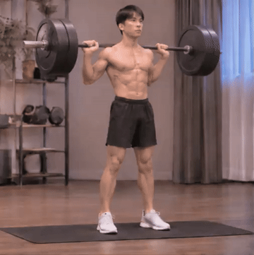</a> <b>Barbell Squat Breakdown</b> <a href="https://x.com/0xlangeai/status/2118193839705858256">@0xlangeai</a> · <a href="https://x.com/0xlangeai/status/2118193839705858256">Original post</a> A barbell squat broken down step by step into a looping GIF.</td>
<td width="33%" valign="top"><a href="https://x.com/0xlangeai/status/2118193839705858256">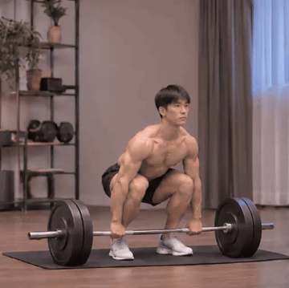</a> <b>Deadlift Breakdown</b> <a href="https://x.com/0xlangeai/status/2118193839705858256">@0xlangeai</a> · <a href="https://x.com/0xlangeai/status/2118193839705858256">Original post</a> A deadlift broken down step by step into a looping GIF.</td>
<td width="33%" valign="top"><a href="https://x.com/0xlangeai/status/2118186890352607550">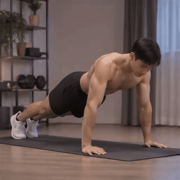</a> <b>Bench Press Breakdown</b> <a href="https://x.com/0xlangeai/status/2118186890352607550">@0xlangeai</a> · <a href="https://x.com/0xlangeai/status/2118186890352607550">Original post</a> A bench press broken down step by step into a looping GIF.</td>
</tr>
</table>

## Memes 表情包

<table>
<tr>
<td width="33%" valign="top"> <b>Dancing Golden Puppy</b> <a href="https://x.com/lemomo_ai/status/2118151430154637420">@lemomo_ai</a> · <a href="https://x.com/lemomo_ai/status/2118151430154637420">Original post</a> A golden puppy wearing sunglasses stands up and dances.</td>
<td width="33%" valign="top"><a href="https://x.com/tetumemo/status/2118131886803534126">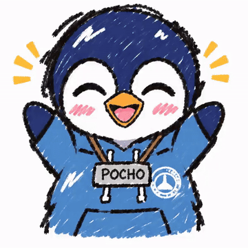</a> <b>Penguin Emotions</b> <a href="https://x.com/tetumemo/status/2118131886803534126">@tetumemo</a> · <a href="https://x.com/tetumemo/status/2118131886803534126">Original post</a> A penguin character's joys and sorrows, animated from a single still image.</td>
<td width="33%" valign="top"><a href="https://x.com/aziz4ai/status/2118183501711462560">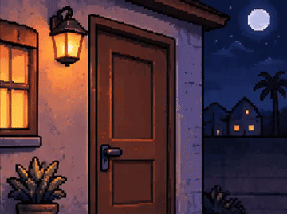</a> <b>Moonlit Cabin</b> <a href="https://x.com/aziz4ai/status/2118183501711462560">@aziz4ai</a> · <a href="https://x.com/aziz4ai/status/2118183501711462560">Original post</a> A funny pixel-art scene at the door of a moonlit cabin.</td>
</tr>
<tr>
<td width="33%" valign="top"><a href="https://x.com/liyue_ai/status/2118183557315371229">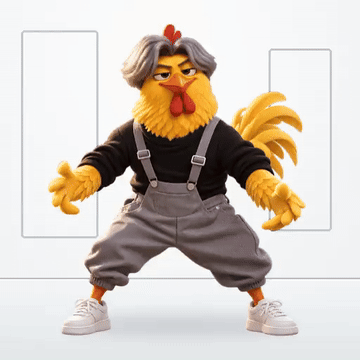</a> <b>Rooster Basketball Dance</b> <a href="https://x.com/liyue_ai/status/2118183557315371229">@liyue_ai</a> · <a href="https://x.com/liyue_ai/status/2118183557315371229">Original post</a> A yellow 3D cartoon rooster in overalls performs a basketball dance — catching, dribbling between the legs, tossing the ball and breaking into the idol dance. <a href="prompts/rooster-basketball-dance.md">📝 Prompt</a></td>
<td width="33%" valign="top"></td>
<td width="33%" valign="top"></td>
</tr>
</table>

## Product & mascots 产品与吉祥物

<table>
<tr>
<td width="33%" valign="top"><a href="https://x.com/yyyole/status/2118174068927013293">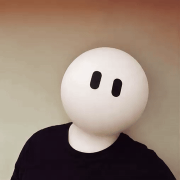</a> <b>Round-Head Mascot</b> <a href="https://x.com/yyyole/status/2118174068927013293">@yyyole</a> · <a href="https://x.com/yyyole/status/2118174068927013293">Original post</a> A white round-headed character with two black oval eyes, facing forward.</td>
<td width="33%" valign="top"><a href="https://x.com/gosrum/status/2118135904779055540">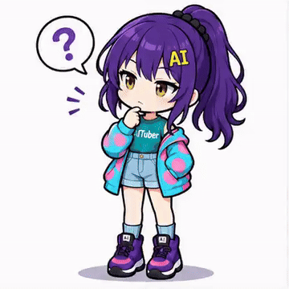</a> <b>Puzzled Purple-Haired Girl</b> <a href="https://x.com/gosrum/status/2118135904779055540">@gosrum</a> · <a href="https://x.com/gosrum/status/2118135904779055540">Original post</a> An anime-style purple-haired girl; the first frame shows a puzzled expression with a '?' bubble.</td>
<td width="33%" valign="top"><a href="https://x.com/798145343h/status/2118164732989608405">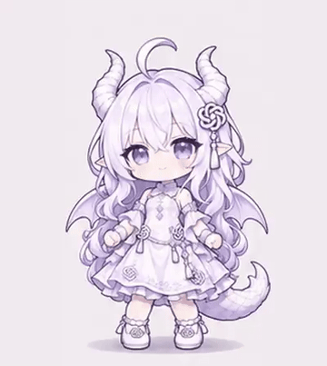</a> <b>GPT and Claude Dance</b> <a href="https://x.com/798145343h/status/2118164732989608405">@798145343h</a> · <a href="https://x.com/798145343h/status/2118164732989608405">Original post</a> GPT and Claude as anime girls dancing.</td>
</tr>
<tr>
<td width="33%" valign="top"><a href="https://x.com/798145343h/status/2118164732989608405">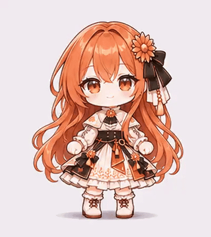</a> <b>GPT and Claude Dance 2</b> <a href="https://x.com/798145343h/status/2118164732989608405">@798145343h</a> · <a href="https://x.com/798145343h/status/2118164732989608405">Original post</a> The second GIF of GPT and Claude as anime girls dancing.</td>
<td width="33%" valign="top"></td>
<td width="33%" valign="top"></td>
</tr>
</table>

## Greetings 问候

<table>
<tr>
<td width="33%" valign="top"> <b>Good Morning Heart</b> <a href="https://x.com/bit_sister/status/2118162095422517527">@bit_sister</a> · <a href="https://x.com/bit_sister/status/2118162095422517527">Original post</a> A girl makes a heart with both hands against pink cherry blossoms — a GM greeting GIF.</td>
<td width="33%" valign="top"></td>
<td width="33%" valign="top"></td>
</tr>
</table>

## Discord & community Discord 与社群

No GIFs listed yet.

## Animated icons & assets 动态图标与素材

<table>
<tr>
<td width="33%" valign="top"><a href="https://x.com/koguGameDev/status/2118144025886921043">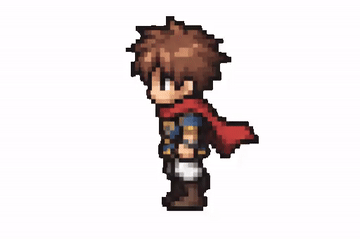</a> <b>Pixel Game Character Walk</b> <a href="https://x.com/koguGameDev/status/2118144025886921043">@koguGameDev</a> · <a href="https://x.com/koguGameDev/status/2118144025886921043">Original post</a> A pixel-art game character in a red cloak, walking.</td>
<td width="33%" valign="top"></td>
<td width="33%" valign="top"></td>
</tr>
</table>

## Action breakdowns 动作拆解

Non-fitness action breakdowns (dance, sports, how-to steps) go here; fitness form breakdowns go under [Fitness breakdowns 健身动作拆解](#fitness).

No GIFs listed yet.

## Animals & pets 动物与宠物

<table>
<tr>
<td width="33%" valign="top"><a href="https://x.com/pradeepXkapoor/status/2118163822938816642">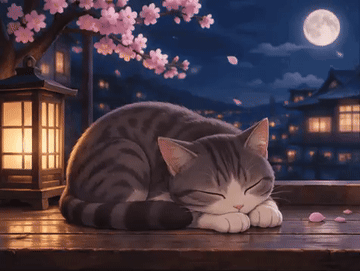</a> <b>Moonlit Cat</b> <a href="https://x.com/pradeepXkapoor/status/2118163822938816642">@pradeepXkapoor</a> · <a href="https://x.com/pradeepXkapoor/status/2118163822938816642">Original post</a> A grey-and-white cat naps with half-closed eyes on a wooden platform under moonlit cherry blossoms.</td>
<td width="33%" valign="top"></td>
<td width="33%" valign="top"></td>
</tr>
</table>

## Photo-style 照片转风格动画

<table>
<tr>
<td width="33%" valign="top"><a href="https://x.com/genel_ai/status/2118164510372688095">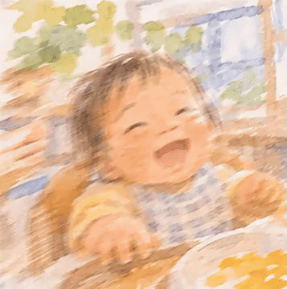</a> <b>Watercolor Baby Laugh</b> <a href="https://x.com/genel_ai/status/2118164510372688095">@genel_ai</a> · <a href="https://x.com/genel_ai/status/2118164510372688095">Original post</a> A real photo turned into a watercolor-style painting, then animated — a laughing baby.</td>
<td width="33%" valign="top"></td>
<td width="33%" valign="top"></td>
</tr>
</table>

## How to use a prompt

One prompt has been shared for the GIFs in this collection so far: 李岳's verbatim prompt for the rooster basketball dance, in `prompts/` — the entry links to it. The other 14 have none; per the collection rule, no Prompt area renders for them.

1. Open a prompt file and copy the block under **Prompt**.
2. Paste it into GPT Images 2.6 (ChatGPT or Codex) and ask for a GIF.
3. Adjust the action, subject, or style, then generate again.

If a creator shared only part of a prompt, the file says so.

## Credits

Every GIF and prompt belongs to its creator, linked from each entry. To request a correction or removal, open an issue.

Browse the full collection on **[SkillU](https://skillu.dev/ai-gif-generator/#cases)**, or [get GIF creation skills](https://skillu.dev/skills/) to make your own.
